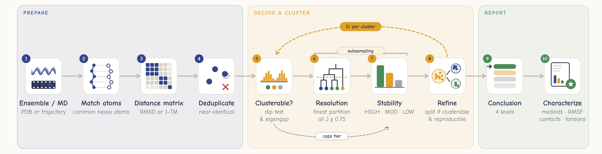

<p align="center">
  
</p>

Struct2Clust groups the structures of one molecule (NMR models, structure
predictions, refinement outputs or MD trajectories) into conformational
states. It reports a cluster as reliable only when the data support it, and
says how strong that support is.

## Features

- **Reproducible clusters.** A cluster counts only if it reappears when the
  data are subsampled; the finest such clustering is selected automatically.
- **Graded conclusion.** Distinct states are claimed only when the data also
  show group structure; otherwise the result says so.
- **Measured reliability.** Error and detection rates were measured in a
  simulation study ([validation](validation/)).
- **Dependent sources (optional).** With `input.groups` (the source of every
  structure: PDB entry, prediction run, …) subsamples keep or drop whole
  sources, so clusters made only of copies or of one run's models are not
  reported as reproducible. It handles the dependence the groups describe, at
  some cost in sensitivity ([METHODS.md](docs/METHODS.md), sections 6 and 13).
- **MD-aware.** Several trajectories, even with different topologies, are
  clustered together, with per-trajectory populations.
- **Descriptive output.** RMSF, contacts, torsions and radius of gyration per
  cluster, print-ready figures, and representative structures.

Protein, RNA, DNA and their complexes are supported.

## Installation

Python 3.10 or newer is required. The test suite is set up to run on Linux and
Windows with Python 3.10-3.12. The exact package versions with which the test
suite was run on Windows 11 with Python 3.12, and with which the regression
reference of the tests was written, are in `requirements/tested-windows-py312.txt`:

```bash
pip install -r requirements/tested-windows-py312.txt
pip install --no-deps .
```

```bash
pip install git+https://github.com/drmnbastrk/struct2clust.git
```

For "--metric tm", install [US-align](https://github.com/pylelab/USalign) and put
it on "PATH". TM-score compares the overall fold; for local and side-chain
differences, use RMSD (the default).

## Quick start

```bash
# a directory of PDB files, or one multi-model PDB file
struct2clust run models/ -o results

# one or several MD trajectories
struct2clust run --topology system.psf --trajectory run1.dcd --trajectory run2.dcd -o results
```

`struct2clust composition results/models sources.csv` shows where the members
of each cluster come from (e.g. which prediction method or PDB entry), and
`struct2clust compare` compares two runs. `struct2clust run --help` lists all
options; `struct2clust config` prints all settings with their defaults.
[example/](example/) holds the scripts that build a synthetic ensemble and
download or prepare five public data sets (NMR ensembles, MD trajectories and
crystal structures), and the commands to cluster them. The data and results
are not part of the repository.

## Output

Each run writes a short report (`report.md`) that also names the residues
where the clusters differ, tables for structures and clusters, a JSON record of all settings, representative structures, per-cluster
VMD/PyMOL scripts that show every member fading from the medoid outwards, and
figures. Every file is described in [docs/OUTPUTS.md](docs/OUTPUTS.md).

## How it works

<p align="center">
  
</p>

1. Match the atoms of all structures and compute pairwise distances ("RMSD" or
   "1-TM-score").
2. Test whether the data contain group structure at all.
3. Cluster with HDBSCAN at the finest resolution whose clusters are all
   reproducible under subsampling, deciding each candidate with enough
   subsamples that the result does not depend on the random seed.
4. Look inside every cluster for further reproducible states, and report for
   every pair of clusters how distinct they are compared with the width of the
   ensemble's states.
5. Grade the conclusion and describe each cluster.

The method, the reasons for each choice and its limitations are in
[docs/METHODS.md](docs/METHODS.md).

## Validation

- **Simulation study** (43 synthetic scenarios with known answers, 50 samples
  each): Structureless data were reported as distinct states in 2 of 250
  ensembles and in none of 350 trajectories; groups at least 5σ apart were found
  in 145 of 150 samples. Weakly separated groups are reported as
  `partition_not_confirmed` or not resolved rather than over-claimed.
- **Real molecules:** Alanine dipeptide trajectories (αR and β separated,
  ARI 0.93-0.99 at 100-2000 frames per trajectory) and adenylate kinase
  ensembles (open and closed forms found in 120 of 120 samples; single forms
  never reported as distinct states, 0 of 120).
- **Reproducibility:** The same input and seed give the same partition; the
  number of subsamples is chosen so that the result does not depend on the
  random seed.

Details, confidence intervals and further checks are in
[docs/METHODS.md](docs/METHODS.md#12-validation); the result tables are in
[validation/results/](validation/results/).

## Limitations

- Clusters are reproducible partitions of the given structures, not proof of
  distinct physical states; reproducibility is not correctness.
- Strongly curved continua and groups closer than about 5σ are hard cases:
  the former are occasionally reported as a reproducible partition, the latter
  often not resolved.
- Trajectories with few transitions between states often end as
  `insufficient_sampling`; population intervals are approximate (about 95%
  coverage in simulations, less with very few transitions).
- Cluster sizes of predicted or deposited ensembles reflect how the structures
  were made, not populations.
- `--metric tm` compares the overall fold only and is slow for large ensembles.

The full list is in [docs/METHODS.md](docs/METHODS.md#13-limitations).

## Documentation

| | |
|---|---|
| [docs/METHODS.md](docs/METHODS.md) | Method, rationale, validation, limitations, references |
| [docs/OUTPUTS.md](docs/OUTPUTS.md) | Every output file and column |
| [docs/CONFIGURATION.md](docs/CONFIGURATION.md) | Every setting and its default |
| [docs/ATOMS.md](docs/ATOMS.md) | Which atoms each selection compares |
| [example/](example/) | Scripts that build or download the example data sets, and the commands to run them |
| [validation/](validation/) | Scripts of the simulation study and of the other checks in METHODS.md |
| [CHANGELOG.md](CHANGELOG.md) | Contents of this version |

## Citing

Please cite Struct2Clust as described in [CITATION.cff](CITATION.cff), and the
methods it builds on:
- HDBSCAN (Campello et al. 2013)
- Cluster-wise stability (Hennig 2007)
- (If used) US-align (Zhang et al. 2022)

Full references are in
[docs/METHODS.md](docs/METHODS.md#references)

## Acknowledgements

Struct2Clust was developed by Derman Basturk with the assistance of Claude Code by Anthropic.

## License

MIT (see [LICENSE](LICENSE))
